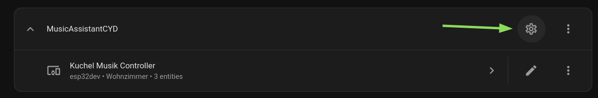
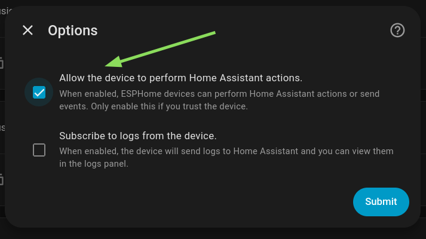

# Installation

There are two essential steps to get this working: **Configuring and flashing ESPHome** and **creating a camera in Home Assistant** that serves the album cover of the song that's playing.

**Overview:**

1. Clone or download this repo
2. **ESPHome**
   - Adjust the config and fill in your credentials
   - Flash ESPHome onto the CYD
   - Add it to HA and enable "Allow this device to execute actions"
3. **Album Cover (Generic Camera)**
   - Create a Generic Camera that shows your player's artwork
   - Put its entity ID into `config.yaml`

---

## ESPHome

### Configuring your Jukebox

Head to the `esphome/` folder:

- Copy `config.yaml.example` and rename it to `config.yaml`
- Copy `secrets.yaml.example` and rename it to `secrets.yaml`

Open `config.yaml` and replace the example values with your own. The device name and friendly name can be chosen freely.

Open `secrets.yaml` and replace the example values with your WiFi credentials, API key, and Home Assistant token.

### Flashing

There are two ways to flash the config: locally via the command line, or through the ESPHome Device Builder add-on. If you're comfortable with Python, the local method is recommended.

#### Method 1: Locally

[Install ESPHome locally](https://esphome.io/guides/installing_esphome/) in version **2026.3.0** (`pip install esphome==2026.3.0`; newer versions use LVGL 9, which breaks image scaling). Then plug in your CYD and make sure you can establish a serial connection (you may need to install UART drivers for your OS).

Navigate to the `esphome/` directory and run:

```bash
cd esphome
esphome run cyd-jukebox.yaml
```

When prompted with `Found multiple options for uploading, please choose one:`, select the USB Serial option.

Done. Easy as cake.

> **Tip:** You can run `esphome run` again later to update the device over-the-air — no USB needed after the first flash.

#### Method 2: ESPHome Device Builder

⚠️ **Before continuing:** You'll need to copy the config values from `esphome/config.yaml` into `esphome/cyd-jukebox-FULL.yaml` manually. At the top of that file there is a `substitutions` section — replace it with the one from your `config.yaml`. This ensures you're using your own values, not the example placeholders. ⚠️

[Set up the ESPHome Device Builder add-on](https://esphome.io/guides/getting_started_hassio/). It has to build with ESPHome 2026.3.0 or older (see the note in the README). Then:

1. Create a new empty device config inside ESPHome Device Builder
2. Edit the YAML — remove anything pre-filled
3. Paste the full contents of `esphome/cyd-jukebox-FULL.yaml`
4. Save
5. Add your secrets: click **Secrets** (top right) and enter the values from `esphome/secrets.yaml`
6. Connect your CYD via USB
7. Compile and upload

Your CYD should now boot, connect to WiFi, and display something.

### Add to Home Assistant and grant permissions

Head to **Settings → Devices & Services**. The CYD should be auto-discovered — if not, open the ESPHome integration and add it manually. The device displays its IP in the logs once it connects to WiFi.

Once added, go back to **Settings → Devices & Services → ESPHome**, find your cyd-jukebox in the device list, click the gear icon, and enable **"Allow the device to perform Home Assistant Actions"**.




The device is now operational.

## Optional: Curate your Playlists Page

The playlist page offers a way to start playing one of your personally curated playlists.
To do that, head over to `esphome/cyd-playlists-page.yaml` if you flashed it locally, or find the `Scrollable playlist list` Section in your ESPHome Device Builder yaml config.

Follow the steps outlined there to add your own playlists

## Album cover (Generic Camera)

The jukebox shows the cover at full size (240×240). It downloads the artwork through a Home Assistant camera that always shows what the player is playing. HA scales the image down on request, and the ESP decodes it in small pieces, so no extra add-on is needed.

### Step 1 — Create the camera

1. Go to **Settings → Devices & Services → Add Integration** and choose **Generic Camera**
2. **Still image URL:** paste this template and replace `media_player.your_player` with your player's entity ID:
   ```jinja
   {{ p if p.startswith('http') else 'http://127.0.0.1:8123' ~ p }}
   ```
   Players that report a relative picture path (starting with `/api/`) are fetched from HA itself. If your HA doesn't listen on port 8123, change the port in the template.
3. Leave **Stream source** empty, set **Content type** to `image/jpeg`
4. Under **Advanced**, enable **Limit refetch to URL change** so HA only downloads the artwork when the track's picture changes
5. Finish the setup, then rename the new camera entity to something recognisable, e.g. `camera.your_player_cover`

### Step 2 — Tell the jukebox about it

Put the camera's entity ID into `config.yaml`:

```yaml
  cover_camera_entity: camera.your_player_cover
```

Flash the jukebox again. The cover is fetched whenever the player's artwork changes.

### Checking that it works

- Open `http://<your-ha-url>/api/camera_proxy/camera.your_player_cover?width=240&height=240` while you're logged in to HA. You should see the current cover.
- The device has two diagnostic buttons in HA: **Cover Reload** downloads the cover again, **Cover Test Pattern** shows colour bars instead.
- In the device logs, every cover prints a line like `Cover 256x256 (1/1) -> 240 px (16->15 blocks): 10752 bytes, total 233 ms`.

### Multiple devices

Each jukebox needs its own camera for its own media player. Create one Generic Camera per player (same template, different `media_player` entity) and set `cover_camera_entity` next to `media_player_entity` in each device's config.

If you flash several devices from one `config.yaml`, override the per-device values on the command line:

```bash
esphome run cyd-jukebox.yaml --device <ip> \
  -s device_name cyd-jukebox-kitchen -s friendly_name "Kitchen Jukebox" \
  -s media_player_entity media_player.kitchen \
  -s cover_camera_entity camera.kitchen_cover
```

### Troubleshooting

| Symptom                               | Likely cause                                                                              |
| ------------------------------------- | ----------------------------------------------------------------------------------------- |
| Log says `HTTP 401`                   | `ha_token` in `secrets.yaml` is wrong or misses the `Bearer ` prefix                      |
| Log says `HTTP 404`                   | `cover_camera_entity` doesn't match the camera's entity ID                                |
| Log says `HTTP 500` or the URL fails  | The camera can't load the picture; check the still image template in the camera settings |
| `unsupported JPEG (progressive?)`     | The artwork is a progressive JPEG, which the ESP's built-in decoder can't read            |
| `Not enough RAM for the cover`        | Something else in the config uses a lot of RAM; the cover needs about 95 KB               |
